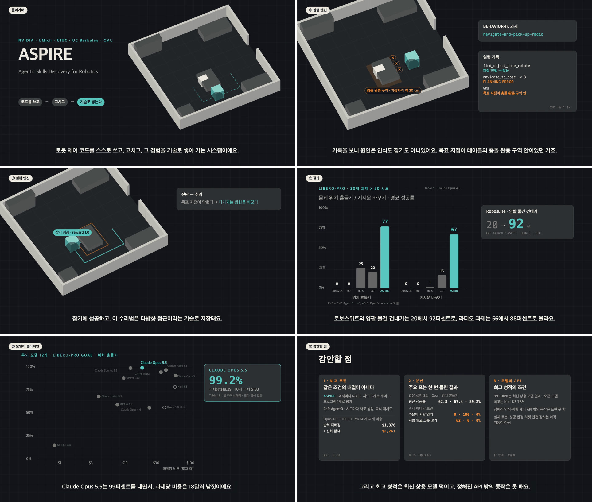

# paper-explainer-video

논문(PDF·arXiv 링크·텍스트)을 3–5분짜리 내레이션 설명 영상(MP4 + 자막)으로 만드는 Claude 스킬입니다.

## 설치

Claude Code에서:

```
/plugin marketplace add t09n0tch/paper-explainer-video-marketplace
/plugin install paper-explainer-video@paper-explainer
```

저장소: https://github.com/t09n0tch/paper-explainer-video-marketplace

설치 후 "이 논문 영상으로 만들어줘"라고 하면 됩니다. 업데이트는 `/plugin marketplace update paper-explainer`.

## 예시: ASPIRE (NVIDIA, 2026)

[ASPIRE: Agentic Skills Discovery for Robotics](https://research.nvidia.com/labs/gear/aspire/assets/aspire.pdf) 논문으로 만든 6분 15초짜리 한국어 설명 영상입니다. 17개 장면, SunHi 음성, 1920×1080.

[](https://github.com/t09n0tch/paper-explainer-video-marketplace/releases/download/examples/aspire-film.mp4)

▶ [영상 보기 (MP4, 22.6 MB)](https://github.com/t09n0tch/paper-explainer-video-marketplace/releases/download/examples/aspire-film.mp4) · [대본 narration.md](examples/aspire/narration.md) · [자막 narration.srt](examples/aspire/narration.srt)

### 이렇게 요청했습니다

사용자가 입력한 건 명령 한 줄과 질문 두 개에 대한 답이 전부입니다.

> **👤 사용자**
>
> ```
> /paper-explainer-video:paper-explainer-video https://research.nvidia.com/labs/gear/aspire/assets/aspire.pdf
> ```

> **🤖 Claude**
>
> 논문 전체(부록 포함 41쪽)를 읽고, 화면에 쓸 수치와 출처(표·그림 번호)를 `facts.md`로 정리했습니다. 17개 장면의 대본을 쓰고, 그동안 이 컴퓨터에서 쓸 수 있는 음성 샘플을 만들었습니다. 그리고 두 가지를 물었습니다.
>
> **어떤 목소리로 할까요?**
> - SunHi (추천): Microsoft 신경망, 여성, 자연스러움 (인터넷 필요)
> - InJoon: Microsoft 신경망, 남성
> - Yuna: macOS 시스템 음성, 오프라인
>
> **초안이 17개 장면, 약 6분입니다. 길이는 어떻게 할까요?**
> - 약 5분으로 줄이기 (추천)
> - 약 6분 그대로

> **👤 사용자**
>
> 목소리: **SunHi** · 길이: **6분 그대로**

> **🤖 Claude**
>
> 모든 문장을 음성으로 만들고, 그 길이에 맞춰 장면을 하나씩 만들었습니다. 장면마다 스틸 컷을 찍어 자막 겹침, 잘린 글자, 숫자를 확인하고 고친 뒤 전체를 MP4로 내보냈습니다.
>
> 결과물: `film.mp4`, `narration.srt`, `narration.md`, `facts.md`, `index.html`(브라우저 미리보기)
>
> 영상에서 실제 값이 아닌 부분도 알렸습니다. 진화 탐색 장면의 후보 점수는 화면에 '예시'로 표시했고, 방 배치와 책 애니메이션은 단순화한 그림입니다.

명령은 플러그인으로 설치했을 때 기준입니다. 슬래시 명령 없이 "이 논문 영상으로 만들어줘"와 함께 PDF 링크나 파일을 줘도 됩니다.

## 필요한 것

| 도구 | 설치 |
|---|---|
| ffmpeg | macOS `brew install ffmpeg` · Windows `winget install ffmpeg` · Linux `apt-get install ffmpeg` |
| Playwright + Chromium | `pip install playwright && python -m playwright install chromium` |
| edge-tts (기본 음성) | `pip install edge-tts` (인터넷 필요) |

없는 것은 Claude가 작업 중에 설치를 안내합니다.

## 기본값과 변경

| | 기본값 |
|---|---|
| 음성 | Microsoft 신경망 음성 `ko-KR-SunHiNeural` (edge-tts). 못 쓰면 이 컴퓨터의 다른 음성으로 자동 대체 |
| 영상 | H.264 (libx264), CRF 18, preset medium, 1920×1080 30fps |
| 오디오 | AAC 192 kbps |

바꾸고 싶으면 Claude에게 말하면 됩니다.

- "다른 목소리 들려줘" → 이 컴퓨터에서 가능한 음성 샘플을 만들어 고르게 해줍니다.
- "이번 영상만 남자 목소리로" → 그 영상의 `script.json`에만 저장
- "앞으로 계속 Yuna 목소리로", "앞으로 CRF 23으로" → `~/.config/paper-explainer-video/config.json`에 저장되어 이후 모든 영상에 적용
- "기본값으로 되돌려" → 위 파일 삭제

직접 하려면 `skills/paper-explainer-video/scripts/settings.py show | set | reset`.
